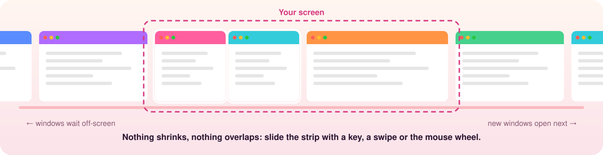
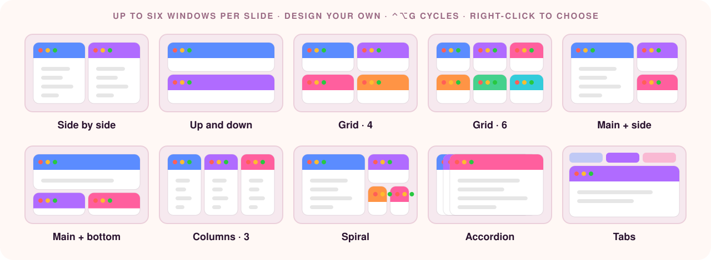
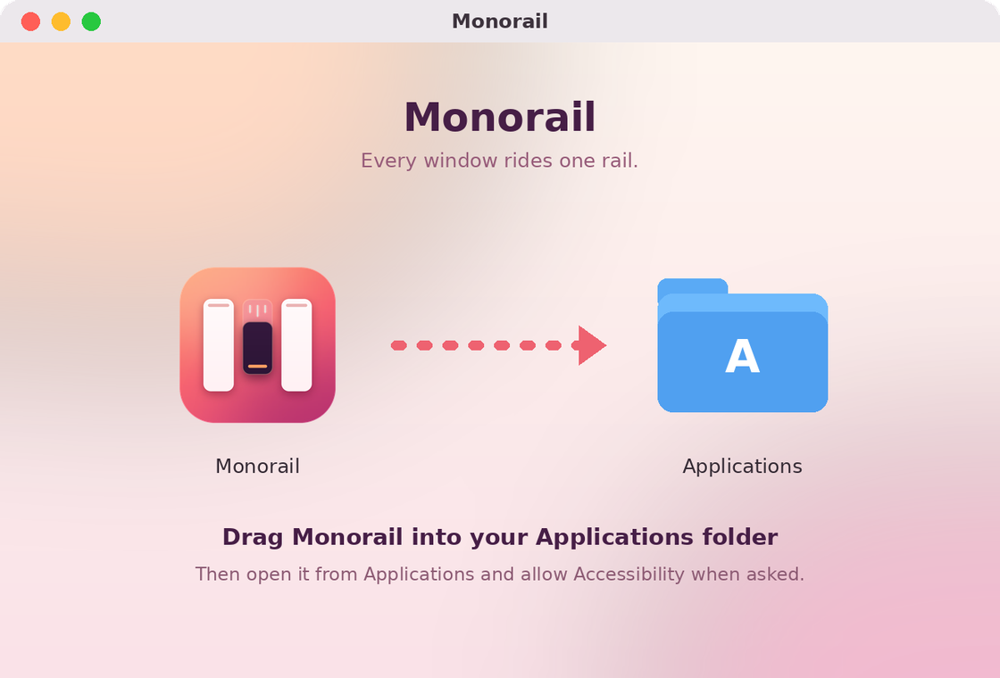

<div align="center">



<br>

[](https://github.com/ashfordeOU/monorail/releases/latest)


[](https://github.com/ashfordeOU/monorail/actions/workflows/ci.yml)

[Install](#install) · [Getting started](#getting-started) · [Shortcuts](#keyboard-shortcuts) · [FAQ](#faq) · [Build from source](#build-from-source)

</div>

---

Grid tilers squeeze every new window into the space that's already there.
**Monorail does the opposite.** Each window is a column on a horizontal strip
that runs past the edges of your display. Open a window and it slides in next
to the one you're using; everything else keeps its size. Move focus and the
strip glides just far enough to bring the window into view.

<p align="center"></p>

## Highlights

<table>
<tr>
<td width="50%" valign="top">

### 🚝 One endless strip
Every display, Space and workspace gets its own strip. New windows open next
to the one you're using, nothing ever shrinks to make room, and windows off
screen wait at the edges.

</td>
<td width="50%" valign="top">

### 🧩 Smart slides
Windows of the same app share a slide: two Safari windows side by side,
terminals four to a slide. Lone windows pair up when you ask. Your own
pairings stick until you **Reset to smart pairs**.

</td>
</tr>
<tr>
<td valign="top">

### 🎚️ The slider
A glass mini-map of the strip glides in as you move. Hover a slide for a
**live preview** of its windows, drag to slide everything along, click to jump.
It's in the menu bar too.

</td>
<td valign="top">

### 🗺️ Overview
<kbd>⌃⌥O</kbd> shows every slide of every workspace on one colourful canvas.
Click to jump, drag windows between slides, rename, close or minimise them
right there.

</td>
</tr>
<tr>
<td valign="top">

### ⌨️ No chords needed
Tap the right <kbd>⌥</kbd> for **slide mode**, then just press <kbd>←</kbd> <kbd>→</kbd>.
Or hold <kbd>⌥</kbd> and turn the mouse wheel, swipe on the trackpad, or scroll
over the menu bar. Full shortcuts are there when you want them.

</td>
<td valign="top">

### 📐 Layouts that stay put
Grid, side by side, up and down, main + side, main + bottom or tabs, up to six
windows a slide. Resize one and its neighbours follow; apps that move
themselves get snapped back.

</td>
</tr>
<tr>
<td valign="top">

### 🗂️ Workspaces
Up to nine per display, each with its own name and colour. <kbd>⌃⌥1</kbd>–<kbd>⌃⌥9</kbd>
switches; add <kbd>⇧</kbd> to take the window with you.

</td>
<td valign="top">

### 🔒 Native, private, safe
Swift, AppKit and SwiftUI. No account, no telemetry. One permission
(Accessibility). Pause or quit and every window comes back on screen; undo any
change with <kbd>⌃⌥Z</kbd>.

</td>
</tr>
<tr>
<td valign="top">

### 🧲 Snap, swap and pair
Drag a window to the top of the screen and pick a layout to drop it into.
Drag it over its slide-mate and they swap sides as you go. Save a slide as an
**app pair** and open both apps together any time.

</td>
<td valign="top">

### 🎛️ Profiles, marks and a scratchpad
Separate **profiles** for work and home, **marks** to jump to a window with one
letter, a **scratchpad** window that drops in and hides with <kbd>⌃⌥`</kbd>, and
**park** a whole workspace in the Dock until you need it.

</td>
</tr>
</table>

<p align="center"></p>

### How it compares

| | Monorail | Grid tilers | Snapping tools |
| --- | :---: | :---: | :---: |
| New windows keep everyone's size | ✅ | ❌ squeezes the rest | ✅ |
| Arranges windows for you | ✅ | ✅ | ❌ manual |
| Unlimited windows per screen | ✅ on a strip | ❌ ever-smaller tiles | ❌ they overlap |
| Mouse-first controls (wheel, slider, menu bar) | ✅ | ❌ | partly |
| Groups windows by app | ✅ | ❌ | ❌ |
| Live overview you can rearrange | ✅ | ❌ | ❌ |
| Free and open source | ✅ AGPL | varies | mostly paid |

## Install

### Download

1. Download **Monorail-x.y.z.dmg** from the [latest release](https://github.com/ashfordeOU/monorail/releases/latest).
2. Open it. The installer window shows Monorail next to your Applications folder: **drag Monorail onto Applications**.
3. Open Monorail from Applications and allow **Accessibility** access when asked. The welcome tour walks you through it.

<p align="center"></p>

> [!NOTE]
> Release builds are not yet notarized by Apple. The first time you open Monorail,
> macOS may say it can't verify the developer. Open **System Settings → Privacy & Security**
> and click **Open Anyway**. The Terminal installer below avoids this step.

### Terminal

```bash
curl -fsSL https://raw.githubusercontent.com/ashfordeOU/monorail/main/scripts/install.sh | bash
```

This downloads the latest release, installs it in `/Applications` and opens it.

### Updates

Monorail updates itself. It checks GitHub once a day, puts a dot on its menu
bar icon and an **Update to …** item at the top of its menu when a new version
is out, and offers **Install and
Relaunch** (or shows **Update** in the menu bar slider): it downloads the
release from GitHub, checks it against the published SHA-256 checksum and
Monorail's code signature, swaps it in and reopens, with your windows where
they were. Turn on **Install updates automatically** in **Settings → General**
to skip the question, or use **Check for Updates…** in the menu any time.

### Requirements

- macOS 13 Ventura or later
- Apple silicon or Intel (universal binary)
- A trackpad, only if you want swipe gestures

## Getting started

When Monorail first opens, a short welcome tour walks you through granting
Accessibility access and the easiest ways to get around.

### Slide mode

Tap the **right ⌥ Option** key on its own. A small cheat sheet appears at
the bottom of the screen, and until you press <kbd>Esc</kbd> (or pause for a
few seconds) plain keys drive Monorail:

| Key | What it does |
| --- | --- |
| <kbd>←</kbd> <kbd>→</kbd> | Slide to the previous / next window. |
| <kbd>⇧←</kbd> <kbd>⇧→</kbd> | Move the window along the strip. |
| <kbd>↑</kbd> <kbd>↓</kbd> | Move between windows stacked in a column (add <kbd>⇧</kbd> to reorder). |
| <kbd>R</kbd> | Step through preset widths (¼ ⅓ ½ ⅔ ¾). |
| <kbd>F</kbd> | Fill the screen. Press again to go back. |
| <kbd>C</kbd> | Centre the window. |
| <kbd>1</kbd>–<kbd>9</kbd> | Jump to a column. |
| <kbd>-</kbd> <kbd>=</kbd> | Narrower / wider. |
| <kbd>[</kbd> <kbd>]</kbd> | Stack into the left column / unstack. |
| <kbd>T</kbd> <kbd>W</kbd> <kbd>P</kbd> <kbd>D</kbd> | Float, tabs, pin, send to the next display. |
| <kbd>Esc</kbd> <kbd>Return</kbd> | Done. Any other key also ends slide mode and goes to your app. |

The trigger key can be right ⌥, ⌘, ⌃ or ⇧ in **Settings → Motion & Input**.
Holding the key as a normal modifier never turns slide mode on, only a tap does.

### Slides and the overview

With **Group windows into slides by app** on (the default), Monorail fills
the strip with full-screen slides:

- Windows of the same app share a slide: two side by side, or four in a 2×2 grid for terminals (Terminal, iTerm, Ghostty, Warp, kitty, Alacritty, WezTerm).
- A new window of an app that's not on the strip yet gets a slide of its own. Pressing <kbd>⌃⌥A</kbd> pairs lone windows of different apps (or turn on pairing as they open in **Settings → Layout**).
- Open a second window of an app that is sharing a slide, and the two windows move to a slide of their own.
- Windows that come back return to exactly where they were: unhidden, unminimised, reopened from the Dock after closing, or after quitting and relaunching the app.

**Resize by hand, and the slide follows.** Drag the edge of a window in a
slide and the windows next to it resize live to fill the space. When you let
go, a small popup offers **Keep**, **Own slide** (move this window to a slide
of its own), **Move others out** (keep it here, move the rest to a new slide)
or **Undo**. Ignore it and it fades away.

**Undo anything.** <kbd>⌃⌥Z</kbd> (or <kbd>Z</kbd> in slide mode, or **Undo
Layout Change** in the menu) steps back through your recent layout changes:
moves, resizes, pairings, layouts and resets.

**Layouts stay put.** Some apps (Firefox, for one) occasionally resize or
move their own windows. Monorail notices that it wasn't you — no mouse button
was down — and snaps the window straight back. Dragging and resizing by hand
still work as before. Turn this off in **Settings → Layout** if you prefer.

**Your own pairings stick.** Pair windows yourself (say one Safari and one
Finder window) by dragging in the overview or with <kbd>⌃⌥[</kbd> / <kbd>⌃⌥]</kbd>,
and Monorail keeps that slide as you made it: new windows won't break it up
or squeeze into it, and it's saved across Monorail restarts. To go back,
**Reset to smart pairs** (<kbd>⌃⌥A</kbd>, the ✨ button in the menu bar slider,
or the overview) regroups every workspace by app in one step.

Change the tiles per slide (up to six — more gets too crowded) and the layout for any app under **Settings → Apps**.

### Slide layouts

<kbd>⌃⌥G</kbd> (or <kbd>G</kbd> in slide mode) cycles the focused slide through:

| Layout | Arrangement |
| --- | --- |
| Grid | Grows with the count: 2 side by side, 2×2, 3×2. A short last row stretches to fill. |
| Columns | All side by side, full height. |
| Main + side | One large window, the rest stacked beside it. |
| Main + bottom | One large window on top, the rest in a row below. |
| Rows | All stacked, full width. |

<kbd>⌃⌥.</kbd> and <kbd>⌃⌥,</kbd> make the main window larger or smaller;
<kbd>⌃⌥M</kbd> makes the focused window the main one. <kbd>⌃⌥W</kbd> turns a
slide into tabs. Arrow keys move between tiles by where they are on screen, then
on to the next slide. Choose the layout for new slides in **Settings → Layout**.

**Design your own** in **Settings → Layout → Custom slide layouts**: choose how
many columns and how many rows each has ("one big beside two stacked", "two,
big, two"), up to six windows. Pick one from a slide's right-click menu ▸
**Slide Layout**.

**Windows that can't shrink.** Some apps (the App Store, a few settings
windows) have a minimum size bigger than half the screen. Monorail notices
when a window refuses its tile, gives it a slide of its own, and remembers
the app so its windows open on their own slide from then on.

**Swap and resize inside a slide.** Drag a window by its title bar over
another window in the same slide and the two trade places as you drag, the
other one sliding across to the side you came from; in a main layout the
window takes over the main spot. Drag the edge between two windows and the
neighbour grows or shrinks to match.

### Snap layouts picker

Drag any window towards the top of the screen and a strip of layouts drops
down: halves, thirds, two thirds, quarters and full screen. Let go over a zone
and the window snaps there, floating. Turn it off in **Settings → Layout**.
If macOS also tiles windows dragged to the very top edge, you can switch that
off in System Settings → Desktop & Dock → Windows.

### Saved layouts

Arrange things the way you like for a task, then **Saved Layouts → Save
Current Layout…** in the menu and give it a name ("Coding", "Writing"). Later,
choose it from **Saved Layouts** and every open window that matches goes back
to its slide, in every workspace: same app and title first, then any window of
the same app. Windows that aren't in the layout stay, after it.

### After a restart

Monorail remembers your slides by app and window title. When your Mac
restarts and apps reopen their windows, each one goes back to the slide and
workspace it was in.

### Snapping floating windows

Need one window somewhere specific for a moment? <kbd>⌃⌥⌘</kbd> plus a key snaps
the focused window (floating it first if it was tiled):

| Keys | Snap to |
| --- | --- |
| <kbd>⌃⌥⌘←</kbd> <kbd>⌃⌥⌘→</kbd> <kbd>⌃⌥⌘↑</kbd> <kbd>⌃⌥⌘↓</kbd> | Left, right, top or bottom half |
| <kbd>⌃⌥⌘D</kbd> <kbd>⌃⌥⌘F</kbd> <kbd>⌃⌥⌘G</kbd> | First, centre or last third |
| <kbd>⌃⌥⌘E</kbd> <kbd>⌃⌥⌘T</kbd> | First or last two thirds |
| <kbd>⌃⌥⌘U</kbd> <kbd>⌃⌥⌘I</kbd> <kbd>⌃⌥⌘J</kbd> <kbd>⌃⌥⌘K</kbd> | Top-left, top-right, bottom-left, bottom-right quarter |
| <kbd>⌃⌥⌘↩</kbd> / <kbd>⌃⌥⌘C</kbd> | Maximise / centre |
| <kbd>⌃⌥⌘⌫</kbd> | Restore: back where it was (back on the strip if it was tiled) |

### Right to left

Set **Strip direction** to **Right to left** in **Settings → Layout** and the
first slide sits at the right edge, new windows open to its left, and keys,
swipes, the slider bar and the overview all follow.

Press <kbd>⌃⌥O</kbd> (or <kbd>O</kbd> in slide mode, or **Overview** in the
menu bar) to see every slide of every workspace at once:

- **Click** a window to jump to it, or a workspace title to switch to it.
- **Drag a window** onto another slide to group it there, or into the gap between slides to give it a column of its own. It can go to another workspace too.
- **Drag a slide** by its ≡ handle to reorder the strip.
- **Drop a window on the bin** at the top to close it.
- **Arrow keys** move a highlight between windows, <kbd>↩</kbd> jumps to it, <kbd>⌫</kbd> closes it.
- Hold <kbd>⌥</kbd> and **pinch** on the trackpad to open the overview; pinch out to close it.
- Turn on **Show live previews** to see window contents. This needs Screen Recording permission; without it you see app icons and titles.

### Slider bar

**Click the Monorail icon** in the menu bar for the slider, every slide as a
card, and pause, overview and settings buttons. Right-click (or ⌃-click) the
icon for the full menu.

While the strip moves, a slider bar fades in at the bottom of the screen:
every slide in the workspace as a small tile with its apps' icons, and a
highlighted frame for the part that's on screen.

- **Hover** a tile for a live preview of that slide's windows, laid out as they are on screen; click one to jump straight to it.
- **Drag** the frame, or anywhere on the bar, or just **scroll** over it, and all your windows slide along.
- **Click** a tile to jump to that slide.
- **Dots** on the left switch workspaces; hover one to see its name, right-click to rename it. The grid button on the right opens the overview.
- In previews and the overview, every window has **close, minimise and full-screen** buttons, and a right-click menu to **rename** it, give it its own slide, or move it to another workspace.

In **Settings → Appearance** you can keep it on screen all the time (windows
then leave room for it), move it to the top, or turn it off.

### Workspaces

Give an app a home workspace in **Settings → Apps** and its new windows
always open there (Slack in "Chat", Mail in "Personal").

Name your workspaces ("Work", "Personal", "Design") in **Settings → General**,
or right in the overview: click the pencil (or right-click a dot on the slider
bar) and type the new name in place. Each workspace
has its own colour in the overview and the slider bar.

Each display has four workspaces by default (up to nine in **Settings → General**).
<kbd>⌃⌥1</kbd>–<kbd>⌃⌥9</kbd> switches workspace, and <kbd>⌃⌥⇧1</kbd>–<kbd>⌃⌥⇧9</kbd>
moves the focused window to one. The menu bar shows where you are (`2 · 3/5` is
workspace 2, slide 3 of 5). Switching to a window with ⌘Tab takes you to its workspace.

### Profiles

A profile is a whole set of workspaces, for keeping work and home (or two
clients) apart. Add profiles in **Settings → General → Profiles**, then switch
with <kbd>⌃⌥0</kbd> or **Profile** in the menu bar. Windows of the other
profiles wait out of sight, each workspace remembering its slides. Turn on
**Only show workspaces in use** and the dots, menus and overview list just the
workspaces you are using, plus one empty one.

### Marks and the scratchpad

- **Marks**: press <kbd>⌃⌥⇧;</kbd> then a letter to mark the focused window; later <kbd>⌃⌥;</kbd> and the same letter jumps straight back to it, wherever it is. Marked windows show their letter in the overview.
- **Scratchpad**: <kbd>⌃⌥⇧`</kbd> makes the focused window the scratchpad (a notes app or a terminal, say). <kbd>⌃⌥`</kbd> drops it in over everything, centred; press again to tuck it away.

### App pairs

Right-click a window in a slide (in the slider's preview or the overview) and
choose **Save Slide as App Pair…**. Later, **App Pairs** in the menu bar opens
those apps, launching any that aren't running, and puts them together in one
slide with the same layout.

### Parking a workspace

**Workspaces → Park Workspace** in the menu bar (or right-click a workspace in
the overview) minimises all its windows to the Dock. **Bring Back** puts every
one of them back on exactly the same slides.

### Attention markers

When an app shows a badge on its Dock icon (unread mail, a new message), its
windows get a small red dot on the slider bar, in the overview and in window
search, so you can see which slide wants you.

### With the mouse

- Hold <kbd>⌥</kbd> and **scroll**. With a mouse wheel each notch moves one window; on a trackpad the strip follows your fingers.
- **Scroll over the menu bar**. No keys needed.
- **Click ‹ ›** next to the Monorail icon in the menu bar.
- **Click** any window, even the thin edge of one off-screen, and the strip scrolls to show it.

The menu bar icon shows where you are (`3/8`), lists the windows on the
current strip, and has Pause, Search Windows, Retile and Settings.

## Keyboard shortcuts

If you prefer chords to slide mode, all shortcuts start with <kbd>⌃⌥</kbd> by default. In **Settings → Shortcuts**
you can switch the prefix to <kbd>⌥</kbd>, <kbd>⌘⌥</kbd> or <kbd>⌃⌘</kbd> in
one step, rebind any action and give an action more than one shortcut.
Shortcuts are stored by physical key, so they stay on the same keys with
AZERTY, QWERTZ, Dvorak and other layouts.

| Action | Shortcut |
| --- | --- |
| Focus left / right | <kbd>⌃⌥H</kbd> <kbd>⌃⌥L</kbd> · <kbd>⌃⌥←</kbd> <kbd>⌃⌥→</kbd> |
| Focus up / down in a stack | <kbd>⌃⌥K</kbd> <kbd>⌃⌥J</kbd> · <kbd>⌃⌥↑</kbd> <kbd>⌃⌥↓</kbd> |
| Focus first / last column | <kbd>⌃⌥Home</kbd> <kbd>⌃⌥End</kbd> |
| Overview | <kbd>⌃⌥O</kbd> · <kbd>⌃⌥Tab</kbd> |
| Search windows | <kbd>⌃⌥Space</kbd> |
| Switch to workspace 1–9 | <kbd>⌃⌥1</kbd> … <kbd>⌃⌥9</kbd> |
| Move window to workspace 1–9 | <kbd>⌃⌥⇧1</kbd> … <kbd>⌃⌥⇧9</kbd> |
| Move column left / right | <kbd>⌃⌥⇧H</kbd> <kbd>⌃⌥⇧L</kbd> · <kbd>⌃⌥⇧←</kbd> <kbd>⌃⌥⇧→</kbd> |
| Move window up / down in a stack | <kbd>⌃⌥⇧K</kbd> <kbd>⌃⌥⇧J</kbd> · <kbd>⌃⌥⇧↑</kbd> <kbd>⌃⌥⇧↓</kbd> |
| Send window to next display | <kbd>⌃⌥D</kbd> · <kbd>⌃⌥N</kbd> |
| Cycle width forward / backward | <kbd>⌃⌥R</kbd> <kbd>⌃⌥⇧R</kbd> |
| Narrower / wider | <kbd>⌃⌥-</kbd> <kbd>⌃⌥=</kbd> |
| Full width on / off | <kbd>⌃⌥F</kbd> |
| Centre column | <kbd>⌃⌥C</kbd> |
| macOS full screen | <kbd>⌃⌥⇧F</kbd> |
| Reset to smart pairs (regroup by app) | <kbd>⌃⌥A</kbd> |
| Stack into the column on the left / right | <kbd>⌃⌥[</kbd> <kbd>⌃⌥]</kbd> |
| Pop out of a stack to the left / right | <kbd>⌃⌥⇧[</kbd> <kbd>⌃⌥⇧]</kbd> |
| Next slide layout | <kbd>⌃⌥G</kbd> |
| Main window larger / smaller | <kbd>⌃⌥.</kbd> <kbd>⌃⌥,</kbd> |
| Make main window | <kbd>⌃⌥M</kbd> |
| Tabbed column on / off | <kbd>⌃⌥W</kbd> · <kbd>⌃⌥⇧T</kbd> |
| Pin column to left / right edge | <kbd>⌃⌥P</kbd> <kbd>⌃⌥⇧P</kbd> |
| Float / tile window | <kbd>⌃⌥T</kbd> |
| Mark window / jump to mark | <kbd>⌃⌥⇧;</kbd> then a letter · <kbd>⌃⌥;</kbd> then the letter |
| Show / hide scratchpad | <kbd>⌃⌥`</kbd> |
| Make window the scratchpad | <kbd>⌃⌥⇧`</kbd> |
| Next profile | <kbd>⌃⌥0</kbd> |
| Undo last layout change | <kbd>⌃⌥Z</kbd> |
| Retile everything | <kbd>⌃⌥Esc</kbd> |
| Pause / resume | <kbd>⌃⌥Q</kbd> |

Jumping to a slide by number is <kbd>1</kbd>–<kbd>9</kbd> in slide mode, and
can be bound to any keys in Settings. Every shortcut is also listed under
**Keyboard Shortcuts** in the menu bar, where choosing one runs it.

## Mouse and trackpad

- **Click** any window, including the thin edge of one parked off-screen, and the strip scrolls to show it.
- **Drag** a window by its title bar onto another column to reorder the strip. Dragging a window out of a stack unstacks it. Drag it over a window in its own slide to swap the two, or to the top of the screen for the snap layouts picker.
- **Resize** a window's edge to change its column's width.
- **Scroll** while holding <kbd>⌥</kbd> (you can choose ⌘, ⌃ or ⌃⌥ instead), or with no keys over the menu bar. A mouse wheel moves one window per notch; a trackpad or Magic Mouse moves the strip with your fingers.
- **‹ › buttons** next to the menu bar icon step one window at a time.
- **Hot edges** (optional, in **Settings → Motion & Input**): rest the pointer against the left or right edge of the screen and the strip slides that way.
- **Swipe** with three or four fingers, no keys, once you turn it on in **Settings → Motion & Input**. If macOS uses the same finger count to switch Spaces, **Settings → General → Mac setup** shows you where to change it.
- **Pinch** with <kbd>⌥</kbd> held to open or close the overview.
- On Force Touch trackpads you feel a light **tap** each time the strip lands on a slide (turn it off in **Settings → Motion & Input**).
- **Focus follows mouse** and **mouse follows focus** are optional and off by default.

## Settings

Everything is set in a standard Settings window, and changes apply immediately.

| Pane | What you can change |
| --- | --- |
| General | Launch at login, pause, what clicking the menu bar icon does, workspaces per display, update checks, menu bar position indicator, where new windows open, Mac setup checks |
| Layout | Strip direction, grouping into slides by app, windows per slide, slide layout, gaps between windows and at screen edges (down to zero), default width, width presets, centring behaviour, keep each window's own height, tab bar height |
| Motion & Input | Slide mode key, scroll modifier, menu bar scrolling, ‹ › buttons, three/four-finger swipe, sensitivity, direction, animation speed, focus follows mouse, mouse follows focus |
| Appearance | Slider bar (while sliding, always or never; top or bottom), focus border with colour and width, dimming of inactive windows |
| Apps | Per-app rules: always float, windows per slide, slide layout, default width, open at the start, next to focus or at the end |
| Shortcuts | Modifier prefix, every binding, extra bindings, restore defaults |

Settings are saved to `~/Library/Application Support/Monorail/settings.json`,
and the strip layout to `layout.json` in the same folder.

**Mac setup** checks for Accessibility access, other window managers that
might move windows too (Rectangle, Magnet, Amethyst, AeroSpace, yabai and
others), Stage Manager, “Displays have separate Spaces” and conflicting
trackpad gestures. Each check links to the right System Settings pane.

## Automation

Every action has a `monorail://` URL (older `macslider://` links still work), so you can drive Monorail from
Raycast, Alfred, Shortcuts, Keyboard Maestro or a shell script:

```bash
open -g monorail://focus-right
```

The app also includes a small command-line tool. Link it onto your `PATH`:

```bash
sudo ln -sf /Applications/Monorail.app/Contents/Resources/monorail /usr/local/bin/monorail
```

Then run any action:

```bash
monorail cycle-width
```

Run `monorail --help` for the full list of actions. `settings` and `welcome`
open those windows.

## How it works

Monorail lays out each strip as a row of columns in its own coordinate
space and maps the visible part onto the display. macOS won't put a window
entirely off-screen, so columns that scroll out of view are **parked** at the
display edge with a few points showing. Click a parked window and it slides
back into view.

The layout model (`Sources/MonorailCore`) is plain Swift with no AppKit
code, so it is unit-tested on macOS and Linux. The app
(`Sources/Monorail`) applies that model to real windows:

- **Accessibility (`AXUIElement`, `AXObserver`)** moves and resizes windows and follows window creation, focus, minimising and closing.
- **A `CGEventTap`** handles global shortcuts, slide mode and strip scrolling, and passes every other event straight through.
- **Mission Control Spaces** are read through the system window server, so each Space keeps its own layout. If that lookup ever fails, Monorail treats each display as one Space instead of breaking.
- **Multitouch input** is read directly from the trackpad for three- and four-finger swipes. It is only loaded when that option is on.
- **Animations** use a short ease-out curve. Windows are resized once, then slid into place, so apps don't have to re-layout their content on every frame.

## Privacy

Monorail needs one permission, **Accessibility**, which macOS requires
before any app can move other apps' windows. You can revoke it at any time in
**System Settings → Privacy & Security → Accessibility**.

Live previews in the overview are optional and need **Screen Recording**
permission. Previews are drawn on your Mac and never stored or sent anywhere.

Monorail has no account, analytics or telemetry. Its only network requests go
to this repository's GitHub releases: a daily check for a new version and,
when you accept one, its download. Both can be turned off in **Settings → General**.

## Build from source

You need Xcode 15 or later (or the matching Swift toolchain) on macOS 13 or later.

```bash
git clone https://github.com/ashfordeOU/monorail.git
cd monorail
make test      # run the unit tests
make app       # build dist/Monorail.app (universal, ad-hoc signed)
make package   # also build the .zip, .dmg and SHA256SUMS
make run       # build and open the app
```

### Signing

macOS ties the Accessibility permission to the app's code signature. Release
builds are signed with Monorail's own certificate, so the permission carries
over from one version to the next. (Updating from a release before 0.2.2 needs
one last re-grant: remove Monorail from **Privacy & Security → Accessibility**
with **–**, then open it again.)

The certificate is self-signed and lives in two repository secrets,
`MACSLIDER_SIGNING_CERT` and `MACSLIDER_SIGNING_PASSWORD`. To create or replace
it, run this on your Mac. It uses the GitHub CLI if it's installed, and
otherwise walks you through pasting the two secrets:

```bash
scripts/make-signing-cert.sh
```

Local builds are signed ad hoc unless you set `SIGN_IDENTITY` to a code-signing
identity (a name or SHA-1 hash, such as a Developer ID) before running
`scripts/build-app.sh`. After installing an ad-hoc build, switch Monorail off
and on in **Privacy & Security → Accessibility**.

### Project layout

```
Sources/MonorailCore/    Layout model: strips, slides, layouts, grouping, keymap, settings (no AppKit, tested on macOS and Linux)
Sources/Monorail/        macOS app: engine, input, overlays, slider, overview, menu bar, settings, updater
Tests/                   Unit tests for the layout model
Resources/Info.plist     App bundle metadata
assets/                  App icon, installer background and README artwork
scripts/                 Build, package, install, signing, artwork and command-line tools
.github/workflows/       CI on every push; signed releases on demand
```

## Troubleshooting

- **Shortcuts do nothing.** Check that Monorail is enabled in **Privacy & Security → Accessibility**. Then use **Settings → General → Check again**.
- **A window won't tile.** Some apps have fixed-size windows, or open panels instead of standard windows. These float on purpose. Press <kbd>⌃⌥T</kbd> to tile one anyway.
- **Windows jumped around after a display change.** Press <kbd>⌃⌥Esc</kbd> to retile.
- **Everything's in a mess.** Pause with <kbd>⌃⌥Q</kbd>. Every window comes back on screen, and you can move them by hand.

## FAQ

**Does Monorail replace macOS Spaces or Mission Control?**
No. It works alongside them: each Space keeps its own strip, and full-screen apps are left alone.

**Will it fight with my other window tools?**
Turn off other window managers' snapping (Rectangle, Magnet and the like) and Stage Manager. **Settings → General → Mac setup** checks for these for you.

**What happens to my windows if I quit?**
Every window is put back fully on screen, where you can move it by hand. Next time Monorail starts it restores your layout.

**Why does it need Accessibility access?**
macOS requires it before any app can move other apps' windows. That's the only permission Monorail needs. Live previews optionally use Screen Recording; nothing ever leaves your Mac.

**Some app's windows won't tile.**
Dialogs, file pickers and fixed-size windows float on purpose. Press <kbd>⌃⌥T</kbd> to tile one anyway, or set a rule for the app in **Settings → Apps**.

**Is it free?**
Yes. Monorail is free and open source under the GNU AGPL v3.0.

## Contributing

Bug reports and pull requests are welcome. See [CONTRIBUTING.md](CONTRIBUTING.md).

## License

Copyright © 2026 Ashforde OÜ.

Monorail is free software: you can redistribute it and/or modify it under the
terms of the [GNU Affero General Public License v3.0](LICENSE) as published by
the Free Software Foundation.
